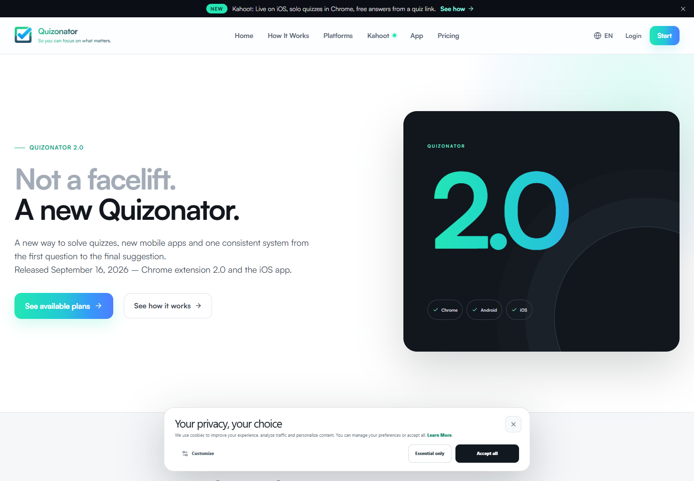
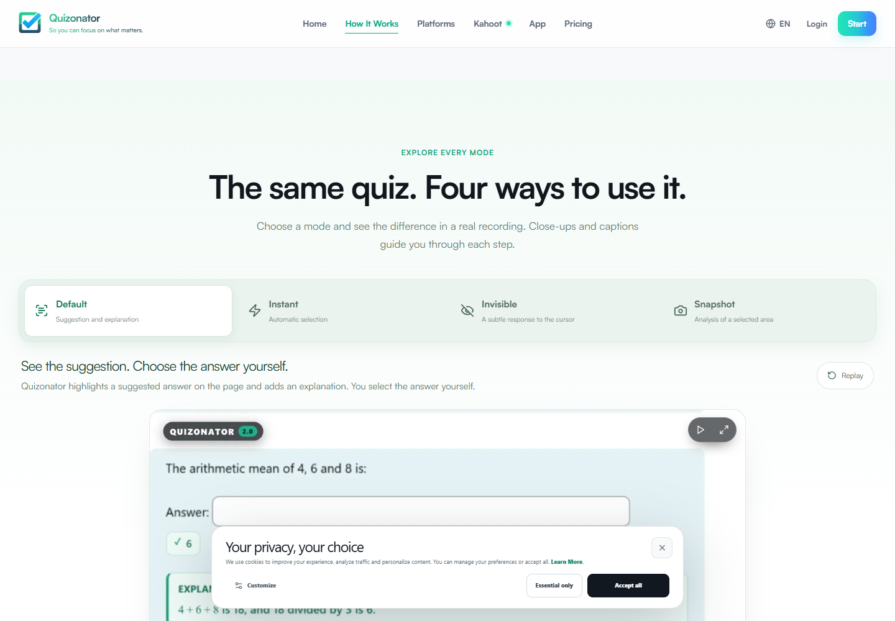

# Quizonator public UI observations

**Inspection date:** 2026-11-02  
**Evidence:** REA records `ev_2876f68…`, `ev_5b1af60…`, `ev_220eaa6…`, `ev_d242ba7…`, and `ev_97da396…` in [`REFERENCE_PRODUCT.md`](REFERENCE_PRODUCT.md).

## Screens and layouts

### Quizonator 2.0 page — VERIFIED

The captured first viewport is a marketing page rather than the installed quiz-solving product. It includes a black announcement strip, a white navigation bar, a spacious two-column hero, and a dark product-mark panel with cyan/blue text. The header links to Home, How It Works, Platforms, Kahoot, App, Pricing, Login, and Start. The hero links to plans and the how-it-works page. The initial screenshot also shows a centered cookie banner near the bottom.

Below the hero, the accessibility capture contains feature cards for a simpler workflow, difficult questions, context, account continuity, mobile apps, and plans; cards for Chrome, Android, and iOS; a product-direction section; and a footer with product, platform, legal, and account links.

### How It Works page — VERIFIED as a public demonstration

The page starts with a large headline, explanatory copy, Add to Chrome and mobile-app links, and a four-step Chrome workflow. A separate mobile workflow describes opening the app, signing in to a quiz page, and starting analysis. Its “same quiz, four ways” region has four tabs and one tab panel. Clicking each tab changes the accessible selected state and panel text.

The demo panels describe the following behaviors:

| Tab | Public demo panel | Evidence |
|---|---|---|
| Default | Suggestion and explanation beside the question; user selects the answer. | [Screenshot](evidence/mode-default.png) |
| Instant | Answer field is selected after analysis; page says quiz submission is separate. | [Screenshot](evidence/mode-instant.png) |
| Invisible | Faint hover hint; clicking question text can select the suggested answer. | [Screenshot](evidence/mode-invisible.png) |
| Snapshot | User captures the screen area; result and explanation appear in a separate panel. | [Screenshot](evidence/mode-snapshot.png) |

The page labels these as recordings/demos and describes at least one quiz page as recreated. They are evidence of public presentation, not a live extension run.

### Chrome Web Store listing — VERIFIED

The listing presents the extension title, publisher, rating/reviews, user count, Add to Chrome button, overview, version/update/size/language details, developer details, and a privacy panel. The captured listing showed a disabled Add to Chrome button and a Sign in link. The listing itself does not expose the installed extension's popup or settings.

### Cookie settings — VERIFIED

Opening Customize on the initial site displayed a dialog headed “Your privacy, your choice.” Necessary was checked and disabled; Analytics and Marketing were optional checkboxes. The dialog provided Hide settings, Essential only, Save preferences, and Accept all buttons. This is website consent UI; it is not evidence of extension settings.

## Navigation and interaction

- Public-site navigation is conventional link-based navigation to product, platform, pricing, app, and legal pages.
- The how-it-works mode selector is a standard tablist with a selected tab and a tab panel; the page's accessible text changed when the tabs were clicked through REA.
- The full-page film exposes playback, restart, volume, fullscreen, timeline, and chapter controls.
- Android and iOS pages expose store links and public demonstration controls/screenshots.
- The extension install CTA links to the official Chrome Web Store listing. No installation action was completed.

## UI information unavailable

No live extension popup, account dashboard, answer panel, provider selector, extension settings, or mobile app screen was opened in a signed-in/runtime session. Product visuals embedded in marketing pages remain reference material; the CheatPet UI will use its own visual assets and copy.
